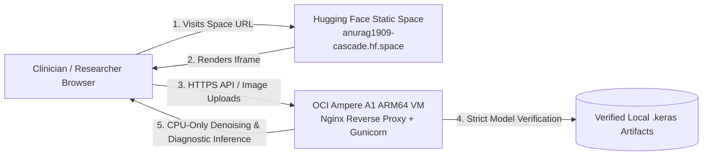

# CASCADE — OCI Always Free ARM64 CPU Backend Deployment Guide

This guide documents the technical procedure for deploying the **CASCADE Clinical Anomalies & Scan Denoising Engine** backend on an **Oracle Cloud Infrastructure (OCI) Always Free Ampere A1 (ARM64)** virtual machine, paired with a zero-cost **Hugging Face Static Space** frontend.

---

## 1. Architecture & Cost Model Overview



* **Zero-Subscription Goal**: The Hugging Face Space runs on the **Static SDK** (`sdk: static`), which requires no Docker container builds, no GPU resources, and zero paid Hugging Face subscriptions. The computationally intensive neural inference executes on an OCI Always Free ARM64 compute instance.
* **Separation of Concerns**: User interactions occur at `https://huggingface.co/spaces/ANURAG1909/cascade`, while form submissions, file uploads, and model evaluations execute against the secure HTTPS backend domain.

---

## 2. OCI Free Tier Prerequisites & Operational Realities

### Account Requirements & Eligibility
1. **Oracle Cloud Account**: Register for an Oracle Cloud account at [cloud.oracle.com](https://cloud.oracle.com/).
2. **Credit Card Verification**: Oracle requires a valid payment card during registration to verify identity. A temporary authorization hold (~$1 USD) is placed and immediately reversed.
3. **Always Free Tenancy Ceiling vs. Recommended Instance Shape**:
   * **Total Monthly Tenancy Allowance**: Up to **4 OCPU cores** and **24 GB RAM** (equivalent to 3,000 OCPU-hours and 18,000 GB-hours per month) across all Ampere A1 instances, plus **200 GB** total boot/block storage.
   * **Conservative Single-Instance Recommendation**: We specifically recommend provisioning **2 OCPUs and 12 GB RAM** for the CASCADE backend VM. While a full 4 OCPU / 24 GB VM is permitted under the monthly ceiling, allocating 2 OCPUs has a substantially higher provisioning success rate in capacity-constrained data centers, leaves room for other services, and provides more than 5x the ~1.5–2 GB peak RAM required by CASCADE.
   * **Home Region Restriction**: Always Free compute instances can **only** be launched in your tenancy's designated **Home Region** (selected permanently at signup). They cannot be launched in secondary subscribed regions.

### Critical Operational Realities & Policy Constraints
* **Regional Capacity Constraints**: In certain OCI Home Regions (e.g., US-Ashburn, Frankfurt, Mumbai), Ampere A1 host capacity can occasionally be constrained ("Out of host capacity" error during creation). If encountered, attempt provisioning in alternate availability domains (e.g., AD-2, AD-3) or retry during off-peak hours.
* **OCI Idle Instance Reclamation Policy**: Oracle's terms explicitly permit the platform to automatically reclaim (stop/terminate) Always Free compute instances if metrics over a rolling 7-day period fall below:
  - CPU utilization (95th percentile): **< 20%**
  - Network utilization: **< 20%**
  - Memory utilization: **< 20%**
  *Policy Compliance*: **Do not attempt to artificially bypass or evade this policy with synthetic cron jobs, fake ping traffic, or artificial CPU loops.** If your instance is reclaimed due to prolonged inactivity, you can restart it from the OCI Console.
* **No Guaranteed 100% Uptime**: Always Free compute instances offer no enterprise Service Level Agreement (SLA). Host maintenance, capacity reclamation, or account tier reviews can cause intermittent downtime. Always Free hosting is ideal for open-source showcases, portfolio demonstrations, and research benchmarking, but is not designed for mission-critical production.
* **No Guaranteed $0 Without Discipline**: Always Free resources remain strictly $0 provided you do not provision paid Intel/AMD compute shapes, exceed 200 GB total storage, attach paid load balancers, or exceed egress bandwidth limits.

---

## 3. Provisioning the OCI Ampere A1 VM

1. Log in to the **OCI Console**.
2. Navigate to **Compute** &rarr; **Instances** &rarr; **Create Instance**.
3. **Configuration**:
   * **Name**: `cascade-cpu-backend`
   * **Placement**: Select an Availability Domain (e.g., `AD-1`).
   * **Image**: **Canonical Ubuntu 22.04 LTS (aarch64)** or **Ubuntu 24.04 LTS (aarch64)**.
   * **Shape**: Click *Change Shape* &rarr; select **Ampere (ARM)** &rarr; **VM.Standard.A1.Flex**.
     - OCPUs: **2** (or up to 4 if dedicated)
     - Memory: **12 GB** (or up to 24 GB)
   * **Networking**:
     - Create new Virtual Cloud Network (VCN) or select existing.
     - Ensure **Assign a public IPv4 address** is checked.
   * **Add SSH Keys**: Upload or paste your public SSH key (`id_ed25519.pub` or `id_rsa.pub`).
   * **Boot Volume**: Default (50 GB) is well within the 200 GB free tier.
4. Click **Create** and wait for the instance status to transition to `RUNNING`. Note its public IP address (`VM_PUBLIC_IP`).

---

## 4. Dual-Layer Firewall Configuration

Incoming traffic must be permitted through both OCI's Cloud Security Lists and the Ubuntu host firewall.

### Layer 1: OCI VCN Ingress Rules
1. In the OCI Console, navigate to **Networking** &rarr; **Virtual Cloud Networks**.
2. Select your VCN &rarr; click on **Security Lists** &rarr; select **Default Security List**.
3. Click **Add Ingress Rules**:
   * **Source CIDR**: `0.0.0.0/0`
   * **IP Protocol**: `TCP`
   * **Destination Port Range**: `80, 443`
   * **Description**: `HTTP and HTTPS public ingress for CASCADE backend`
4. Confirm SSH (`TCP 22`) is also permitted.

### Layer 2: Host OS Firewall (UFW)
SSH into the instance:
```bash
ssh -i /path/to/private_key ubuntu@VM_PUBLIC_IP
```
Configure and enable UFW:
```bash
sudo ufw default deny incoming
sudo ufw default allow outgoing
sudo ufw allow 22/tcp comment 'SSH'
sudo ufw allow 80/tcp comment 'HTTP'
sudo ufw allow 443/tcp comment 'HTTPS'
sudo ufw --force enable
sudo ufw status verbose
```

---

## 5. Host Setup & ARM64 Environment Preparation

Update system packages and install necessary system libraries:
```bash
sudo apt-get update && sudo apt-get upgrade -y
sudo apt-get install -y \
    python3-pip \
    python3-venv \
    python3-dev \
    git \
    nginx \
    certbot \
    python3-certbot-nginx \
    libgl1 \
    libglib2.0-0 \
    htop
```

Clone the repository and set up a clean Python virtual environment:
```bash
sudo mkdir -p /opt/cascade
sudo chown -R ubuntu:ubuntu /opt/cascade
cd /opt/cascade

# Clone repository
git clone https://github.com/ANURAGVIVEK0919/CASCADE-Clinical-Anomalies-Scan-Denoising-Engine-.git .

# Create virtual environment
python3 -m venv venv
source venv/bin/activate

# Upgrade pip and install verified ARM64 dependencies
pip install --upgrade pip
pip install -r deploy/free_cpu_backend/requirements-arm64.txt
```

> [!NOTE]
> `requirements-arm64.txt` installs `tensorflow==2.21.0` using official pre-compiled `manylinux_2_27_aarch64` wheels. No local compilation or C++ build tools are required.

---

## 6. Model Artifact Transfer & Verification

The Hugging Face git repository and GitHub do not contain the large `.keras` model weights. You must securely copy the three verified local artifacts from your development machine to the VM.

### Transfer Commands (Run from Local Development Machine)
```powershell
# From local Windows development machine in PowerShell:
$VM_IP = "YOUR_OCI_VM_PUBLIC_IP"
$KEY = "C:\Users\vivek\.ssh\id_rsa" # Adjust path to your private key

# Create remote experiment directory
ssh -i $KEY ubuntu@$VM_IP "mkdir -p /opt/cascade/artifacts/experiments/unet_residual_edge_v3/run_001"

# Copy baseline models
scp -i $KEY medical_ct_denoiser_full.keras ubuntu@${VM_IP}:/opt/cascade/
scp -i $KEY medical_ct_diagnostic_model.keras ubuntu@${VM_IP}:/opt/cascade/

# Copy Residual U-Net v3 candidate model
scp -i $KEY artifacts/experiments/unet_residual_edge_v3/run_001/candidate_unet_residual_edge_v3.keras ubuntu@${VM_IP}:/opt/cascade/artifacts/experiments/unet_residual_edge_v3/run_001/
```

### Run Artifact Verification Gate on VM
```bash
cd /opt/cascade
source venv/bin/activate
python deploy/free_cpu_backend/verify_backend_models.py /opt/cascade
```

**Expected Verification Output**:
* `medical_ct_denoiser_full.keras`: `23,388,275` bytes | `ef84c7d1d808000a6e52b36cb1fdcbd7c929621d061cafbe61f822c2cf767842`
* `medical_ct_diagnostic_model.keras`: `256,877,707` bytes | `a68b61a14c6ac170ef37a43e7447edeb90fafb3439ff0e0652ec33e1f4b64d41`
* `candidate_unet_residual_edge_v3.keras`: `1,936,708` bytes | `bc396511dfbea8d1f853b2067ededd801b3405b11caeb25157445d581fb1fcea`
* Result: `[SUCCESS] All verified model artifacts match expected digests.`

---

## 7. Systemd Service Setup

Create a systemd unit file to manage the CASCADE backend process automatically with logging and restart-on-failure:

```bash
sudo nano /etc/systemd/system/cascade.service
```

Paste the following configuration:
```ini
[Unit]
Description=CASCADE Clinical Anomalies & Scan Denoising Engine (Gunicorn)
After=network.target

[Service]
User=ubuntu
Group=ubuntu
WorkingDirectory=/opt/cascade
Environment="PATH=/opt/cascade/venv/bin:/usr/local/bin:/usr/bin"
Environment="CUDA_VISIBLE_DEVICES=-1"
Environment="PYTHONDONTWRITEBYTECODE=1"
Environment="PYTHONUNBUFFERED=1"
Environment="CASCADE_UPLOAD_FOLDER=/tmp/cascade_uploads"
ExecStartPre=/opt/cascade/venv/bin/python /opt/cascade/deploy/free_cpu_backend/verify_backend_models.py /opt/cascade
ExecStart=/opt/cascade/venv/bin/gunicorn \
    --bind 127.0.0.1:7860 \
    --workers 2 \
    --threads 4 \
    --timeout 180 \
    --access-logfile /var/log/cascade/access.log \
    --error-logfile /var/log/cascade/error.log \
    app:app

Restart=always
RestartSec=5
StandardOutput=journal
StandardError=journal

[Install]
WantedBy=multi-user.target
```

Create logging directory and start service:
```bash
sudo mkdir -p /var/log/cascade
sudo chown -R ubuntu:ubuntu /var/log/cascade

sudo systemctl daemon-reload
sudo systemctl enable cascade
sudo systemctl start cascade
sudo systemctl status cascade
```

---

## 8. Free Subdomain, Nginx Reverse Proxy & HTTPS

To allow secure iframe embedding inside Hugging Face Spaces, the backend must be accessible over HTTPS with a valid SSL/TLS certificate.

### Free Subdomain Options
1. **DuckDNS** (Free indefinitely):
   * Create an account at [duckdns.org](https://www.duckdns.org/).
   * Create a domain: e.g. `cascade-backend.duckdns.org`.
   * Point it to your `VM_PUBLIC_IP`.
2. **Cloudflare Tunnel / Custom Domain**:
   * Alternatively, use your own domain or Cloudflare free tier.

### Nginx Reverse Proxy Configuration
Create an Nginx server block:
```bash
sudo nano /etc/nginx/sites-available/cascade
```

Paste the following configuration (replace `cascade-backend.duckdns.org` with your actual domain):
```nginx
# Rate-limiting zones: prevent CPU saturation from unauthenticated upload flood
limit_req_zone $binary_remote_addr zone=cascade_api_limit:10m rate=15r/m;
limit_conn_zone $binary_remote_addr zone=cascade_conn_limit:10m;

server {
    listen 80;
    server_name cascade-backend.duckdns.org;

    # Maximum payload size matches app 32 MB limit
    client_max_body_size 32M;

    # General endpoints and dark PACS dashboard viewer
    location / {
        proxy_pass http://127.0.0.1:7860;
        proxy_set_header Host $host;
        proxy_set_header X-Real-IP $remote_addr;
        proxy_set_header X-Forwarded-For $proxy_add_x_forwarded_for;
        proxy_set_header X-Forwarded-Proto $scheme;

        proxy_connect_timeout 180s;
        proxy_send_timeout 180s;
        proxy_read_timeout 180s;

        # IMPORTANT: Do NOT inject 'X-Frame-Options: SAMEORIGIN' or 'DENY'.
        # The CASCADE Flask app sends a scoped Content-Security-Policy:
        # frame-ancestors 'self' https://huggingface.co https://*.hf.space;
        # which permits embedding exclusively within official Hugging Face Spaces.
    }

    # Heavy neural inference endpoints: enforce abuse prevention & rate limiting
    location ~ ^/(process|api/research/predict) {
        limit_req zone=cascade_api_limit burst=5 nodelay;
        limit_conn cascade_conn_limit 2;

        proxy_pass http://127.0.0.1:7860;
        proxy_set_header Host $host;
        proxy_set_header X-Real-IP $remote_addr;
        proxy_set_header X-Forwarded-For $proxy_add_x_forwarded_for;
        proxy_set_header X-Forwarded-Proto $scheme;

        proxy_connect_timeout 180s;
        proxy_send_timeout 180s;
        proxy_read_timeout 180s;
    }
}
```

Enable site and test configuration:
```bash
sudo ln -sf /etc/nginx/sites-available/cascade /etc/nginx/sites-enabled/
sudo rm -f /etc/nginx/sites-enabled/default
sudo nginx -t
sudo systemctl reload nginx
```

### Obtain Free Let's Encrypt SSL/TLS Certificate
```bash
sudo certbot --nginx -d cascade-backend.duckdns.org --non-interactive --agree-tos -m your-email@example.com
```

Verify certificate auto-renewal:
```bash
sudo certbot renew --dry-run
```

Test your backend over HTTPS:
```bash
curl -I https://cascade-backend.duckdns.org/metrics
```
Should return `HTTP/2 200 OK` with `Content-Security-Policy: frame-ancestors 'self' https://huggingface.co https://*.hf.space`.

---

## 9. Logging, Monitoring & Maintenance Commands

* **Live Gunicorn Logs**:
  ```bash
  sudo journalctl -u cascade -f
  ```
* **Nginx Access & Error Logs**:
  ```bash
  sudo tail -f /var/log/nginx/access.log
  sudo tail -f /var/log/nginx/error.log
  ```
* **Resource Utilization**:
  ```bash
  htop
  ```
* **Restarting the Service**:
  ```bash
  sudo systemctl restart cascade
  ```

---

## 10. Security & Non-Clinical Safety Disclaimers

* **Research-Only Prototype**: CASCADE is an exploratory engineering demonstration and research benchmark engine. It is **not** an FDA-cleared, CE-marked, or certified medical device (SaMD).
* **Non-Clinical Environment**: Do not upload un-deidentified patient health information (PHI). Real clinical diagnosis or emergency triage must never rely on this platform.
* **Ephemeral Data Policy**: Uploaded scans are written to `/tmp/cascade_uploads` and securely unlinked on both success and failure within Python `try/finally` blocks.
